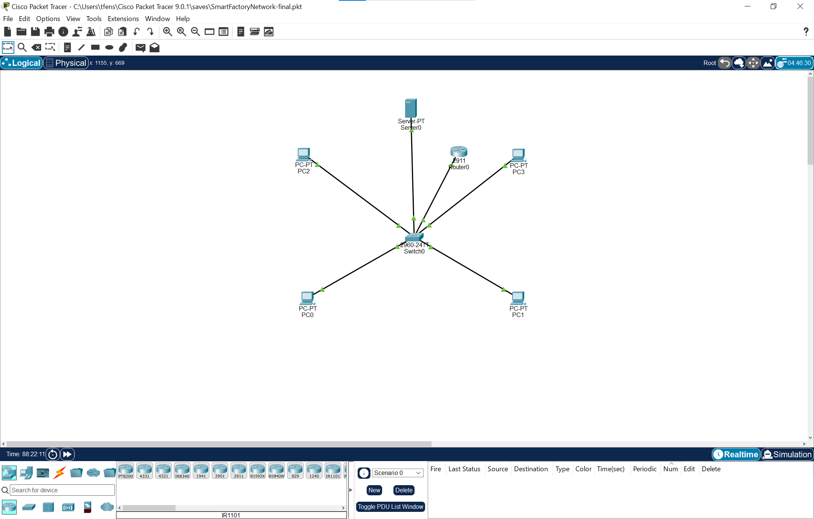
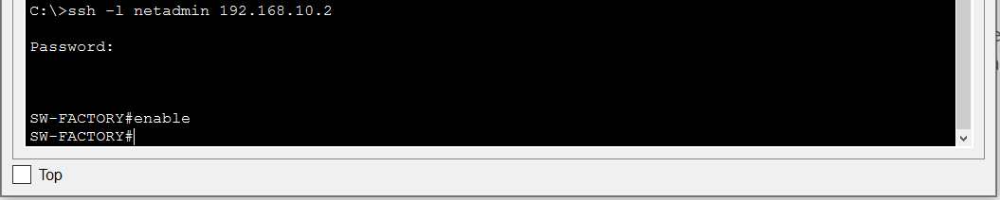
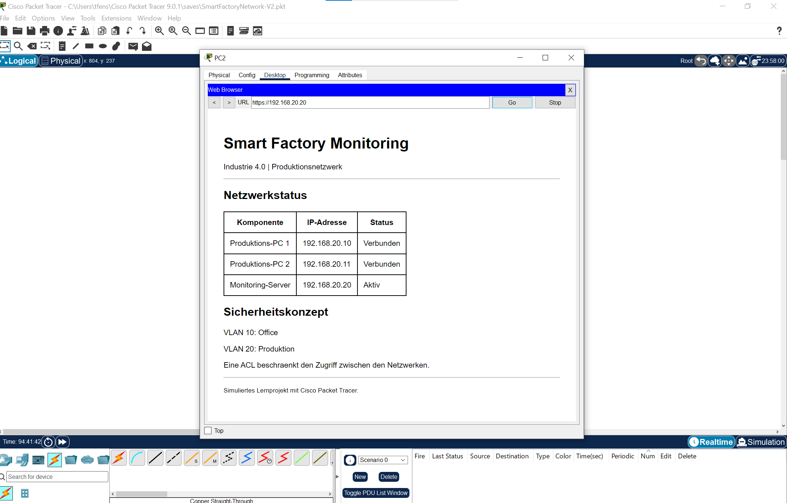
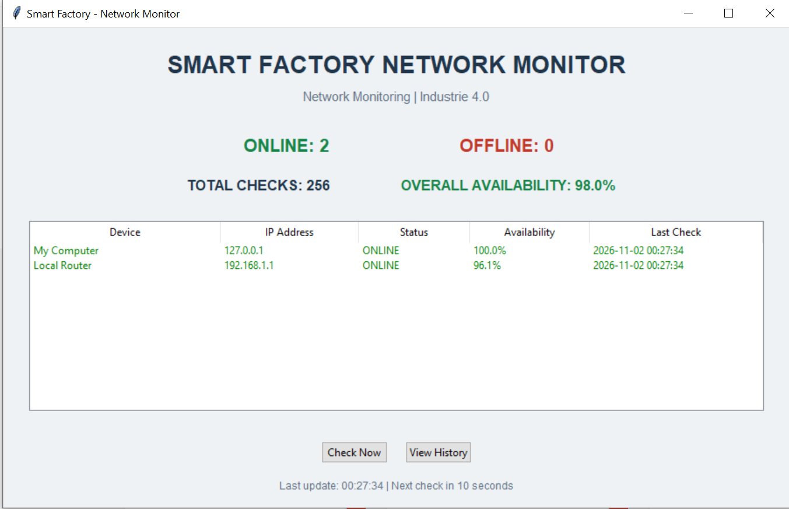

# Smart Factory Network – Industrie 4.0

Ein selbstständiges Portfolio-Projekt zur Planung, Konfiguration und Dokumentation eines segmentierten Smart-Factory-Netzwerks. Das Projekt verbindet eine Netzwerksimulation mit Cisco Packet Tracer und eine ergänzende Python-Anwendung zur Überwachung der IP-Erreichbarkeit.



## Projektüberblick

Ziel des Projekts ist es, typische Grundlagen eines industriellen Netzwerks praktisch umzusetzen: die Trennung von Office- und Produktionsgeräten, die Kommunikation zwischen VLANs, gezielte Zugriffskontrolle sowie sichere Netzwerkadministration.

Das Repository enthält zwei getrennte Demonstrationen:

1. **Cisco Packet Tracer:** simulierte Smart-Factory-Netzwerkinfrastruktur mit VLANs, Inter-VLAN-Routing, DHCP, ACL, Port Security, SSH und einem HTTP-Dashboard.
2. **Python Network Monitor:** eigenständige Windows-Desktop-Anwendung zur regelmäßigen Prüfung konfigurierter IP-Adressen mit Ping sowie zur Speicherung und Anzeige der Prüfhistorie.

> Hinweis: Das HTTP-Dashboard in Packet Tracer ist eine statische Demonstrationsoberfläche. Die Python-Anwendung ist ein separates Monitoring-Beispiel und liest keine Live-Daten direkt aus der Packet-Tracer-Simulation.

## Projektziele

- Office- und Produktionsnetzwerk logisch voneinander trennen.
- VLANs und IEEE-802.1Q-Trunking konfigurieren.
- Inter-VLAN-Kommunikation über Router-on-a-Stick ermöglichen.
- DHCP zur automatischen IPv4-Adressvergabe einrichten.
- Den Datenverkehr mit einer Extended ACL kontrollieren.
- Switchports mit Port Security absichern.
- Die Netzwerkgeräte für die Administration über SSH erreichbar machen.
- Netzwerk-Erreichbarkeit mit Ping-Tests überprüfen.
- Eine ergänzende Python-Anwendung mit grafischer Oberfläche und CSV-Protokollierung entwickeln.

## Technologien und Werkzeuge

| Bereich | Technologien |
| --- | --- |
| Netzwerksimulation | Cisco Packet Tracer |
| Netzwerkgeräte | Cisco Catalyst 2960 Switch, Cisco 2911 Router |
| Segmentierung | VLAN 10, VLAN 20, IEEE 802.1Q |
| Routing | Router-on-a-Stick, IPv4, Subnetting |
| Adressvergabe | DHCP |
| Netzwerksicherheit | Extended ACL, Switch Port Security, SSH |
| Monitoring in Packet Tracer | HTTP-Server, statisches HTML-Dashboard |
| Desktop-Monitoring | Python 3, Tkinter, ICMP/Ping, CSV |
| Versionsverwaltung | Git, GitHub |

## Netzwerkarchitektur

Das simulierte Netzwerk ist in zwei logische Bereiche aufgeteilt:

| VLAN | Name | Netzwerk | Standardgateway | Geräte |
| --- | --- | --- | --- | --- |
| VLAN 10 | OFFICE | `192.168.10.0/24` | `192.168.10.1` | PC0, PC1 |
| VLAN 20 | PRODUCTION | `192.168.20.0/24` | `192.168.20.1` | PC2, PC3, Monitoring-Server |

### IP-Adressierung

| Gerät | IP-Adresse | Standardgateway |
| --- | --- | --- |
| PC0 | `192.168.10.10` | `192.168.10.1` |
| PC1 | `192.168.10.11` | `192.168.10.1` |
| PC2 | `192.168.20.10` | `192.168.20.1` |
| PC3 | `192.168.20.11` | `192.168.20.1` |
| Monitoring-Server | `192.168.20.20` | `192.168.20.1` |

Die genannten Adressen dokumentieren die Netzstruktur und die vorgesehenen Geräteadressen. Im Router sind DHCP-Pools für OFFICE und PRODUCTION eingerichtet. Die Adressen `192.168.10.1–192.168.10.20` und `192.168.20.1–192.168.20.20` sind vom DHCP-Adresspool ausgeschlossen, damit sie für Gateways und fest konfigurierte Geräte verfügbar bleiben.

### VLAN- und Port-Konfiguration

- **VLAN 10 – OFFICE:** Switchports `Fa0/1` und `Fa0/2`
- **VLAN 20 – PRODUCTION:** Switchports `Fa0/3`, `Fa0/4` und `Fa0/5`
- **Trunk-Verbindung:** `Gi0/1` zwischen Switch und Router; VLAN 10 und VLAN 20 werden über IEEE 802.1Q übertragen.

### Inter-VLAN-Routing

Auf dem Cisco 2911 Router sind zwei Subinterfaces eingerichtet:

- `G0/0.10` – Gateway für VLAN 10: `192.168.10.1`
- `G0/0.20` – Gateway für VLAN 20: `192.168.20.1`

Die Subinterfaces ermöglichen die Kommunikation zwischen den beiden IP-Netzen. Welche Verbindungen tatsächlich erlaubt sind, wird zusätzlich durch die ACL-Regeln bestimmt.

## Sicherheitskonfiguration

### Extended Access Control List (ACL)

Die Extended ACL `OFFICE-TO-PRODUCTION` wird eingehend auf dem Router-Subinterface `G0/0.10` angewendet. Sie demonstriert eine grundlegende Zugriffskontrolle zwischen Office und Produktion.

Die dokumentierte Regelstruktur:

- TCP-Pakete mit ACK- oder RST-Flag von Office in Richtung Produktion erlauben.
- ICMP-Echo-Replies in der vorgesehenen Rückrichtung erlauben.
- Anderen IP-Verkehr von Office nach Produktion blockieren.
- Übrigen Verkehr gemäß der abschließenden ACL-Regel behandeln.

Die ACL ist **zustandslos** und keine Stateful Firewall. Sie dient in diesem Projekt zur Demonstration regelbasierter Paketfilterung.

### Switch Port Security

Port Security wurde auf Switchports als zusätzliche Layer-2-Sicherheitsmaßnahme konfiguriert. Die Konfiguration soll den Anschluss nicht autorisierter Endgeräte an geschützten Access-Ports einschränken.


### SSH-Remote-Administration

SSH wurde als verschlüsselter Zugang für die Remote-Administration der Netzwerkgeräte eingerichtet. Die Konfiguration ist im folgenden Screenshot dokumentiert.



## DHCP-Konfiguration

Auf dem Router sind getrennte DHCP-Pools für die beiden Netzwerke eingerichtet:

- `OFFICE` für `192.168.10.0/24`, Standardgateway `192.168.10.1`
- `PRODUCTION` für `192.168.20.0/24`, Standardgateway `192.168.20.1`

Die reservierten Adressbereiche `.1` bis `.20` werden nicht dynamisch vergeben. Dadurch bleiben die Gateway-Adressen und die vorgesehenen festen Geräteadressen außerhalb des dynamischen DHCP-Bereichs.

## Monitoring

### 1. HTTP-Dashboard in Cisco Packet Tracer

Im Produktionsnetzwerk befindet sich ein Monitoring-Server mit einer einfachen HTTP-Oberfläche. Das Dashboard dient als visuelle Demonstration innerhalb der Packet-Tracer-Topologie. Die dargestellten Statuswerte sind statisch und stellen keine automatische Echtzeitüberwachung dar.



### 2. Python Network Monitor

Zusätzlich enthält das Repository eine eigenständige Python-Anwendung mit grafischer Benutzeroberfläche (Tkinter). Sie prüft die Erreichbarkeit konfigurierter IP-Adressen mithilfe des Windows-Ping-Befehls.

**Funktionen:**

- Automatische Erreichbarkeitsprüfung in einem Intervall von 10 Sekunden.
- Anzeige des Gerätestatus (`ONLINE` / `OFFLINE`).
- Anzeige der letzten Prüfung und der Anzahl erfolgreicher bzw. fehlgeschlagener Prüfungen.
- Berechnung einer Verfügbarkeitsquote auf Basis der gespeicherten Prüfergebnisse.
- Manuelle Prüfung über **Check Now**.
- Speicherung der Ergebnisse in `monitoring_log.csv`.
- Laden früherer Ergebnisse und Anzeige der letzten Einträge über **View History**.



**Windows-Anwendung:** [SmartFactoryMonitor.exe herunterladen](python-monitor/SmartFactoryMonitor.exe)  
**Quellcode:** [python-monitor/monitor.py](python-monitor/monitor.py)  
**Ordner:** [python-monitor/](python-monitor/)

Die zu prüfenden Geräte und IP-Adressen werden im `devices`-Dictionary in `python-monitor/monitor.py` festgelegt. In der aktuell veröffentlichten Quellcode-Version sind als Demo-Ziele **My Computer** (`127.0.0.1`) und **Local Router** (`192.168.1.1`) eingetragen. Diese Einträge prüfen den lokalen Rechner und einen Router im lokalen Netzwerk; sie entsprechen nicht den IP-Adressen der Packet-Tracer-Produktionsgeräte. Für andere Umgebungen können die Zielnamen und IP-Adressen im `devices`-Dictionary angepasst werden. Die Anwendung überwacht nur IP-Adressen, die vom Windows-Rechner aus erreichbar sind; sie greift nicht automatisch auf simulierte Packet-Tracer-Geräte zu.

## Nachweise und Screenshots

### VLAN-Konfiguration


Die Nachweise zu Port Security und SSH sind bereits in den entsprechenden Abschnitten der Sicherheitskonfiguration eingebunden, damit sie nicht doppelt angezeigt werden.

## Testergebnisse

| Test | Erwartetes bzw. beobachtetes Ergebnis |
| --- | --- |
| PC0 → PC1 innerhalb von VLAN 10 | Erfolgreich |
| PC2 → PC3 innerhalb von VLAN 20 | Erfolgreich |
| PC0 → Gateway `192.168.10.1` | Erfolgreich |
| PC2 → Gateway `192.168.20.1` | Erfolgreich |
| PC0 → PC2 nach Aktivierung der ACL | Blockiert |
| PC2 → PC0 gemäß konfigurierter ACL-Regeln | Erfolgreich |
| DHCP-Pools für OFFICE und PRODUCTION | Eingerichtet und geprüft |
| Port Security | Konfiguriert; Screenshot als Nachweis vorhanden |
| SSH-Remote-Administration | Konfiguriert; Screenshot als Nachweis vorhanden |

## Repository-Struktur

```text
Smart-Factory-Network-Industrie-4.0/
├── python-monitor/
│   ├── monitor.py
│   ├── SmartFactoryMonitor.exe
│   └── Python_dashboard.PNG
├── SmartFactoryNetwork-V2.pkt
├── Topology-Final.png
├── topology.png
├── Dashboard.png
├── Vlan configuration.png
├── Port security.png
├── SSH-Remote-Administration.PNG
└── README.md
```

## Projektdatei öffnen

1. Cisco Packet Tracer starten.
2. `SmartFactoryNetwork-V2.pkt` aus diesem Repository herunterladen.
3. Die Datei in Packet Tracer öffnen.
4. Router-, Switch-, VLAN- und Sicherheitskonfigurationen in der Simulation untersuchen.

## Python-Anwendung starten

Die Python-Anwendung ist für Windows vorgesehen, da sie den Windows-Ping-Befehl (`ping -n`) verwendet.

**Variante A – Windows-Anwendung**

1. [SmartFactoryMonitor.exe herunterladen](python-monitor/SmartFactoryMonitor.exe).
2. Die heruntergeladene Datei unter Windows starten.

**Variante B – Python-Quellcode**

1. Python 3 installieren, falls es noch nicht vorhanden ist.
2. Das Verzeichnis `python-monitor` öffnen.
3. Im Terminal `python monitor.py` ausführen.
4. Bei Bedarf die Zielgeräte und IP-Adressen im `devices`-Dictionary der Datei `monitor.py` anpassen.

Die Datei `monitoring_log.csv` wird beim Monitoring im Arbeitsverzeichnis angelegt und enthält die protokollierten Prüfergebnisse.

## Was ich in diesem Projekt gelernt habe

- Aufbau und Segmentierung eines IPv4-Netzwerks mit VLANs.
- Konfiguration von Access- und Trunk-Ports.
- Inter-VLAN-Routing mit Router-on-a-Stick.
- DHCP-Pools und Ausschluss reservierter IP-Adressen.
- Grundlegende Netzwerkzugriffskontrolle mit Extended ACLs.
- Absicherung von Switchports mit Port Security.
- Sichere Remote-Administration über SSH.
- Netzwerkdiagnose und systematische Fehlersuche mit Ping-Tests.
- Entwicklung einer Desktop-Anwendung mit Python und Tkinter.
- Protokollierung, Auswertung und Anzeige von Monitoring-Daten mit CSV.
- Strukturierte Dokumentation und Versionsverwaltung mit Git und GitHub.

## Projektstatus

Die Cisco-Packet-Tracer-Topologie und die dokumentierten Netzwerkfunktionen wurden im Rahmen dieses Lern- und Portfolio-Projekts umgesetzt. Die Python-Anwendung ist als ergänzende, eigenständige Monitoring-Demonstration enthalten.

**Projektart:** Selbstständiges Lern- und Portfolio-Projekt  
**Schwerpunkt:** Netzwerktechnik, industrielle Netzwerksegmentierung, IT-Sicherheit und Netzwerk-Monitoring  
**Simulation:** Cisco Packet Tracer  
**Programmiersprache:** Python 3
