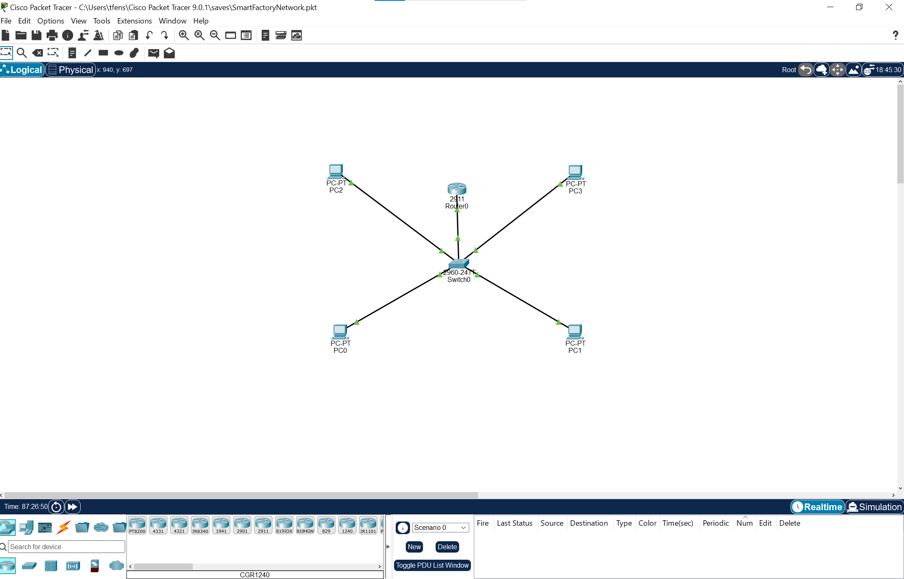

# Smart Factory Network – Industrie 4.0

##

## Projektbeschreibung

In diesem Projekt habe ich ein simuliertes Netzwerk für eine Smart Factory mit Cisco Packet Tracer aufgebaut.

Das Netzwerk ist in zwei logische Bereiche unterteilt: ein Office-Netzwerk und ein Produktionsnetzwerk. Ziel des Projekts ist es, die Grundlagen der industriellen Netzwerksegmentierung, des VLAN-Routings und der Zugriffskontrolle praktisch umzusetzen.

## Projektziele

- Aufbau einer simulierten Netzwerkumgebung mit Cisco Packet Tracer
- Trennung von Office und Produktion mithilfe von VLANs
- Konfiguration von IP-Adressen und Standardgateways
- Kommunikation zwischen verschiedenen IP-Netzwerken über einen Router
- Umsetzung einer grundlegenden Sicherheitsrichtlinie mit einer Access Control List (ACL)
- Überprüfung der Netzwerkverbindungen mit Ping-Tests

## Verwendete Technologien

- Cisco Packet Tracer
- Cisco Catalyst 2960 Switch
- Cisco 2911 Router
- VLANs und IEEE 802.1Q
- Router-on-a-Stick
- IPv4 und Subnetzmasken
- Extended Access Control Lists (ACLs)
- ICMP und TCP

## Netzwerkstruktur

Das Netzwerk besteht aus zwei VLANs:

| VLAN    | Name       | Netzwerk        | Geräte   |
| ------- | ---------- | --------------- | -------- |
| VLAN 10 | OFFICE     | 192.168.10.0/24 | PC0, PC1 |
| VLAN 20 | PRODUCTION | 192.168.20.0/24 | PC2, PC3 |

### IP-Adressierung

| Gerät | IP-Adresse    | Standardgateway |
| ----- | ------------- | --------------- |
| PC0   | 192.168.10.10 | 192.168.10.1    |
| PC1   | 192.168.10.11 | 192.168.10.1    |
| PC2   | 192.168.20.10 | 192.168.20.1    |
| PC3   | 192.168.20.11 | 192.168.20.1    |

## Technische Umsetzung

### 1. VLAN-Konfiguration

Ich habe VLAN 10 für das Office-Netzwerk und VLAN 20 für das Produktionsnetzwerk eingerichtet.

Die Switchports Fa0/1 und Fa0/2 gehören zu VLAN 10. Die Ports Fa0/3 und Fa0/4 gehören zu VLAN 20.

Dadurch werden die Geräte logisch in zwei getrennte Netzwerke aufgeteilt.

### 2. Router-on-a-Stick

Der Switch ist über einen Trunk mit dem Router verbunden. Über diese Verbindung werden die VLANs 10 und 20 mithilfe von IEEE 802.1Q übertragen.

Auf dem Router wurden zwei Subinterfaces konfiguriert:

- G0/0.10 – Gateway für das Office-Netzwerk: 192.168.10.1
- G0/0.20 – Gateway für das Produktionsnetzwerk: 192.168.20.1

Damit können Geräte aus unterschiedlichen VLANs über den Router miteinander kommunizieren, sofern die Sicherheitsregeln dies erlauben.

### 3. Sicherheitskonfiguration mit ACL

Um den Zugriff zwischen Office und Produktion einzuschränken, habe ich eine Extended ACL mit dem Namen `OFFICE-TO-PRODUCTION` erstellt.

Die ACL ist eingehend auf dem Router-Subinterface G0/0.10 angewendet.

Die Sicherheitsregeln haben folgende Aufgaben:

- TCP-Pakete mit ACK- oder RST-Flag von Office nach Produktion erlauben.
- ICMP-Echo-Replies von Office nach Produktion erlauben.
- Anderen IP-Verkehr von Office nach Produktion blockieren.
- Übrigen Verkehr erlauben.

Diese Konfiguration ist eine grundlegende, zustandslose Zugriffskontrolle und keine Stateful Firewall. Sie dient dazu, die Funktionsweise von ACLs praktisch zu demonstrieren.

## Testergebnisse

| Test                                      | Ergebnis    |
| ----------------------------------------- | ----------- |
| PC0 → PC1 innerhalb des Office-VLANs      | Erfolgreich |
| PC2 → PC3 innerhalb des Produktions-VLANs | Erfolgreich |
| PC0 → Gateway 192.168.10.1                | Erfolgreich |
| PC2 → Gateway 192.168.20.1                | Erfolgreich |
| PC0 → PC2 nach Aktivierung der ACL        | Blockiert   |
| PC2 → PC0 nach Anpassung der ACL          | Erfolgreich |

Die Tests bestätigen, dass die VLANs, das Inter-VLAN-Routing und die konfigurierte Zugriffskontrolle wie vorgesehen funktionieren.

## Was ich gelernt habe

Durch dieses Projekt habe ich praktische Erfahrungen mit folgenden Themen gesammelt:

- VLANs und Netzwerksegmentierung
- IP-Adressierung und Standardgateways
- Trunk-Verbindungen und IEEE 802.1Q
- Inter-VLAN-Routing mit Router-on-a-Stick
- Extended ACLs und grundlegende Netzwerksicherheit
- Systematische Fehlersuche mit Ping-Tests und CLI-Befehlen

## Mögliche Erweiterungen

- Integration zusätzlicher Industrie-PCs und IoT-Geräte
- Erweiterung der Sicherheitsregeln nach dem Least-Privilege-Prinzip
- Ergänzung eines separaten Management-VLANs
- Entwicklung eines kleinen Python-Skripts zur Netzwerküberwachung

## Projektstatus

Die grundlegende Netzwerktopologie, das Inter-VLAN-Routing und die ACL-Konfiguration wurden in Cisco Packet Tracer umgesetzt und getestet.

**Projektart:** Selbstständiges Lern- und Portfolio-Projekt
**Schwerpunkt:** Netzwerktechnik, Netzwerksegmentierung und IT-Sicherheit
**Software:** Cisco Packet Tracer

